# Lab6Web: JavaScript DOM dan Event Handling

Praktikum Pemrograman Web, Pertemuan 7.

- Nama: Laurensius Rivaldo Nahak
- NIM: 312310727
- Kelas: I251D

## 1. Tujuan

1. Memahami DOM sebagai representasi dokumen HTML yang dapat diakses lewat JavaScript.
2. Memilih elemen dengan id, class, dan selector CSS.
3. Mengubah teks, atribut, kelas CSS, dan gaya elemen.
4. Menangani event dengan `addEventListener()`.
5. Membuat validasi form dan menampilkan pesan sesuai kondisi input.
6. Membuat halaman interaktif dengan minimal tiga fungsi yang berjalan benar.

## 2. Struktur File

```
Lab6Web/
├── README.md
├── lab6_dom_event/            # Latihan 1-6 dan eksperimen mandiri
│   ├── index.html
│   ├── style.css
│   └── script.js
├── mini_project_workshop/     # Mini project: form pendaftaran workshop
│   ├── index.html
│   ├── style.css
│   └── script.js
└── screenshots/               # Taruh screenshot di sini
```

## 3. Cara Menjalankan

1. Clone atau unduh repository ini.
2. Buka `lab6_dom_event/index.html` atau `mini_project_workshop/index.html` di browser.
3. Buka Developer Tools (F12) > Console untuk memeriksa error.

Tidak perlu instalasi. Script dimuat dengan atribut `defer` agar berjalan setelah HTML selesai diparsing.

## 4. Langkah Kerja dan Hasil

| Latihan | Isi | Event / fitur DOM |
|---|---|---|
| 1 | Mengubah teks judul dan paragraf | `getElementById`, `textContent` |
| 2 | Tombol menampilkan waktu klik | `click`, `Date().toLocaleTimeString()` |
| 3 | Mengubah kelas dan gaya | `classList.toggle()` |
| 4 | Penghitung karakter | `input`, `value.length` |
| 5 | Validasi form pendaftaran | `submit`, `preventDefault()`, regex email |
| 6 | Daftar tugas | `createElement`, `appendChild`, `classList.contains()` |

### Screenshot Latihan

**Latihan 1: Mengubah teks dengan DOM**


**Latihan 2: Event click** (pesan berisi waktu klik)


**Latihan 3: classList.toggle()** (kelas `highlight` dan `teks-besar` aktif)

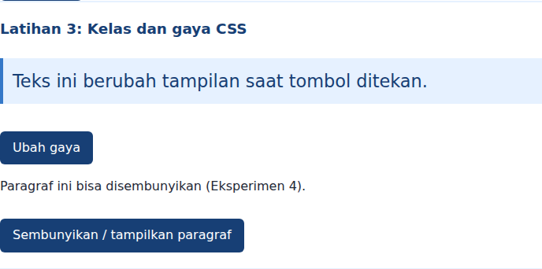

**Latihan 4: Penghitung karakter**

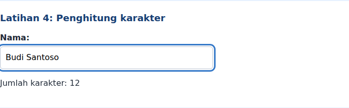

**Latihan 5: Validasi form**

| Kondisi | Screenshot |
|---|---|
| Semua kosong | 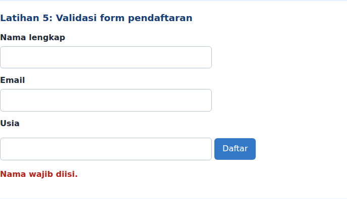 |
| Nama terlalu pendek (`Al`) | 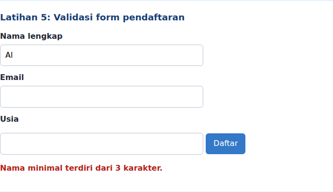 |
| Email tidak valid (`budi@`) | 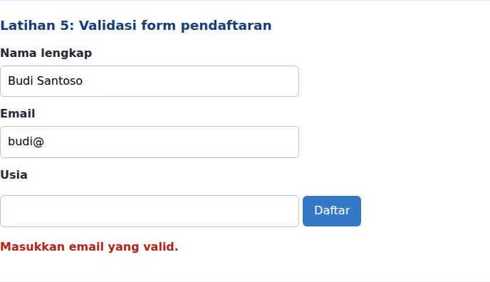 |
| Usia di bawah 17 (`15`) | 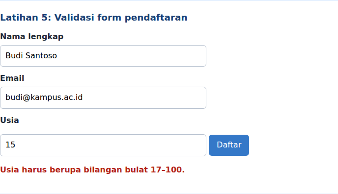 |
| Semua valid | 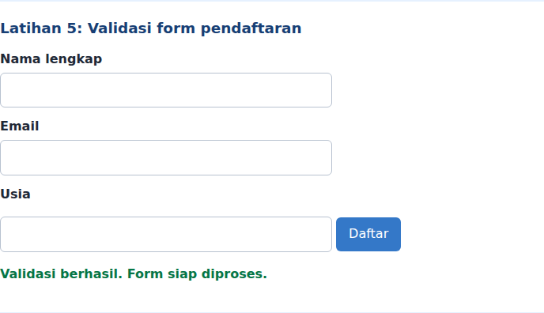 |

**Latihan 6: Daftar tugas** (input kosong, lalu item ditambahkan; item pertama ditandai selesai; tag HTML tampil sebagai teks biasa)

| Kondisi | Screenshot |
|---|---|
| Input kosong | 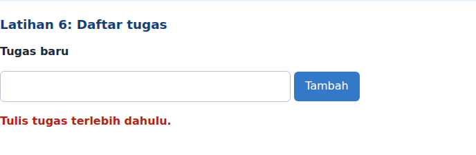 |
| Tiga tugas, satu selesai | 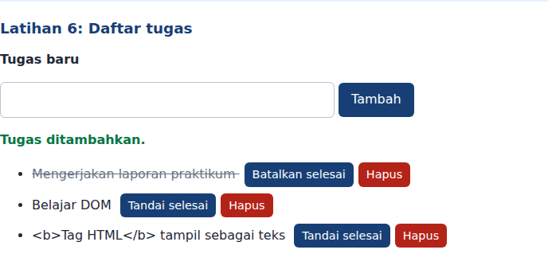 |

### Mini Project: Pendaftaran Workshop

Fungsi interaktif yang diimplementasikan (minimal tiga):

1. **Ringkasan langsung**: panel ringkasan terisi otomatis saat pengguna mengetik (`input`) atau memilih sesi (`change`).
2. **Penghitung karakter** pada kolom catatan (maksimal 120).
3. **Detail sesi** muncul saat dropdown berubah (`change`).
4. **Validasi form** saat `submit`: nama (wajib, minimal 3 karakter), email (wajib, format valid), sesi (wajib). Pesan error tampil di bawah field yang bermasalah, fokus pindah ke field pertama yang salah.
5. **Tombol Hapus isian** (`reset`) mengosongkan form, pesan, dan ringkasan.

Semua teks pengguna ditampilkan dengan `textContent`, bukan `innerHTML`. Tampilan responsif (satu kolom di layar sempit).

### Screenshot Mini Project

| Kondisi | Screenshot |
|---|---|
| Tampilan awal | 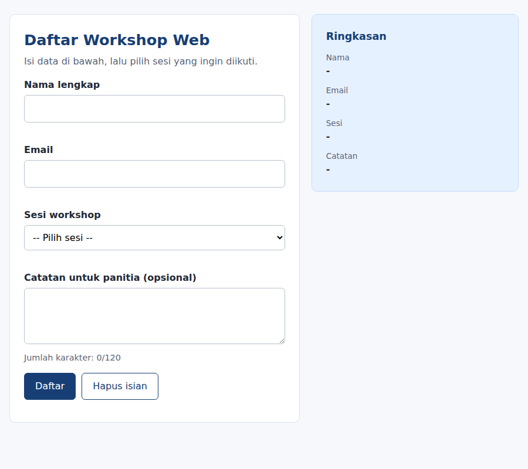 |
| Submit dalam keadaan kosong (error per field) | 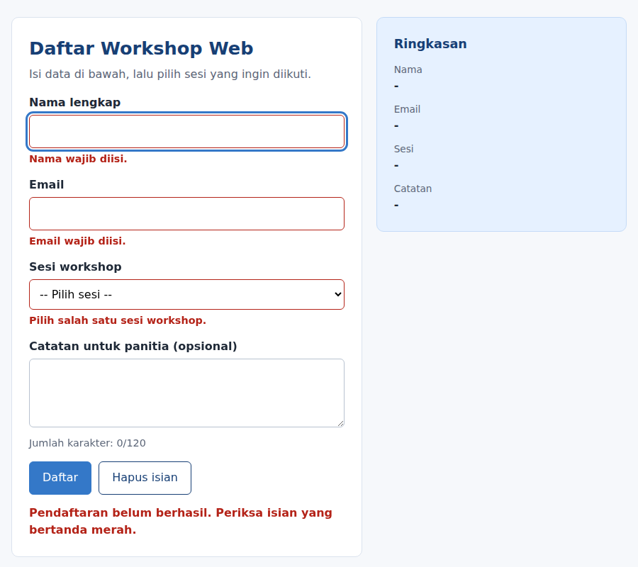 |
| Email tidak valid, sesi dan catatan terisi | 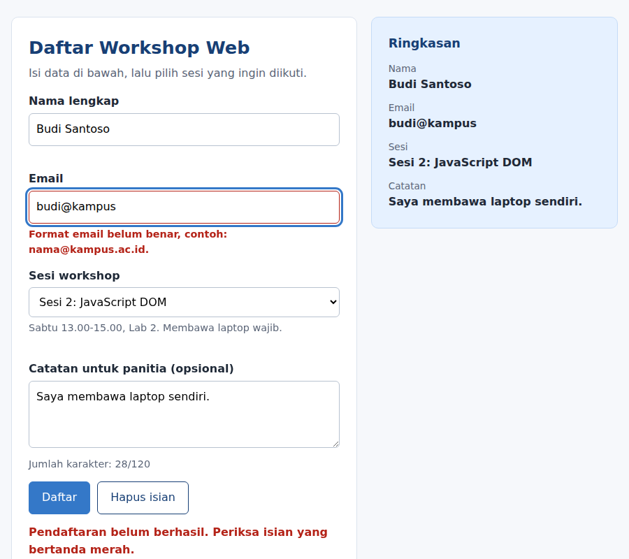 |
| Pendaftaran berhasil | 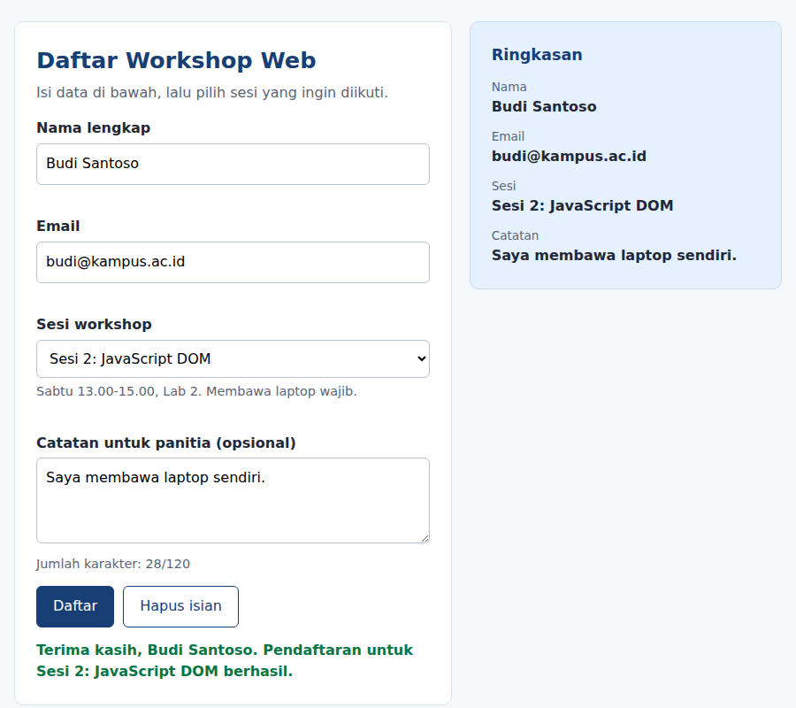 |
| Setelah tombol Hapus isian |  |

## 5. Eksperimen Mandiri

1. **Hapus item To-do**: setiap item punya tombol "Hapus" yang memanggil `item.remove()`.

   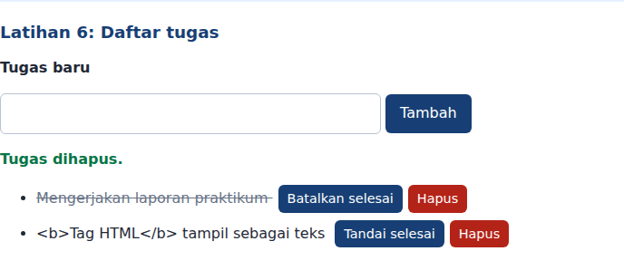
2. **Nama minimal 3 karakter**: ditambahkan pada Latihan 5 dan mini project (`nama.length < 3`).
3. **Event `change` pada dropdown sesi**: menampilkan detail sesi yang dipilih (mini project).
4. **Sembunyikan/tampilkan paragraf**: tombol memakai `classList.toggle("tersembunyi")` dengan `.tersembunyi { display: none; }`.

   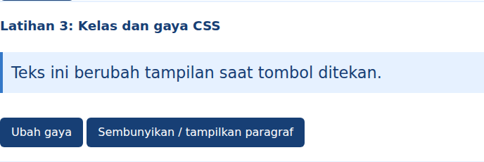
5. **Script tanpa `defer` di `<head>`**: browser menjalankan script saat HTML belum selesai diparsing, sehingga elemen seperti `#judul` belum ada di DOM. `document.getElementById("judul")` mengembalikan `null`, lalu `judul.textContent = ...` memunculkan error `Cannot set properties of null` di Console dan script berhenti. Solusinya: pakai `defer`, letakkan `<script>` di akhir `<body>`, atau bungkus kode dalam event `DOMContentLoaded`.

## 6. Pengujian Validasi Form

| No | Skenario | Input | Hasil yang diharapkan |
|---|---|---|---|
| 1 | Semua kosong | (kosong) | Pesan nama wajib diisi |
| 2 | Nama kosong | email dan usia valid | "Nama wajib diisi." |
| 3 | Nama terlalu pendek | `Al` | "Nama minimal terdiri dari 3 karakter." |
| 4 | Email tidak valid | `budi@` | "Masukkan email yang valid." |
| 5 | Usia di bawah 17 | `15` | "Usia harus berupa bilangan bulat 17-100." |
| 6 | Usia desimal | `20.5` | Pesan usia tidak valid |
| 7 | Semua valid | `Budi`, `budi@kampus.ac.id`, `20` | "Validasi berhasil. Form siap diproses." |

## 7. Jawaban Pertanyaan Evaluasi

1. **DOM** adalah representasi dokumen HTML sebagai struktur pohon objek. Manfaatnya: JavaScript dapat memilih, membaca, dan mengubah elemen, atribut, serta gaya tanpa memuat ulang halaman.
2. `getElementById()` memilih satu elemen berdasarkan id. `querySelector()` memilih elemen pertama yang cocok dengan selector CSS (atau `null`). `querySelectorAll()` mengembalikan `NodeList` berisi semua elemen yang cocok.
3. `addEventListener()` menghubungkan sebuah event pada elemen dengan fungsi handler yang dijalankan saat event terjadi. Contoh event: `click`, `input`, `submit` (juga `change`, `keydown`, `mouseover`).
4. `event.preventDefault()` mencegah perilaku bawaan browser (mengirim form dan memuat ulang halaman), sehingga JavaScript dapat memvalidasi data dan menampilkan pesan lebih dulu.
5. `textContent` memperlakukan nilai sebagai teks biasa sehingga aman. `innerHTML` mengurai nilai sebagai markup HTML, sehingga input pengguna yang tidak dipercaya dapat menyisipkan HTML atau script (XSS).
6. `classList.toggle()` menambahkan kelas jika belum ada dan menghapusnya jika sudah ada. Tampilan berubah hanya dengan satu pemanggilan, sementara aturan visualnya tetap berada di CSS.
7. Skenario pengujian: (a) semua field kosong, (b) email tidak valid, (c) nilai angka di luar rentang, (d) input hanya berisi spasi, (e) semua input valid.

## 8. Referensi

- MDN Web Docs: Introduction to the DOM
- MDN Web Docs: Event reference
- MDN Web Docs: Client-side form validation
